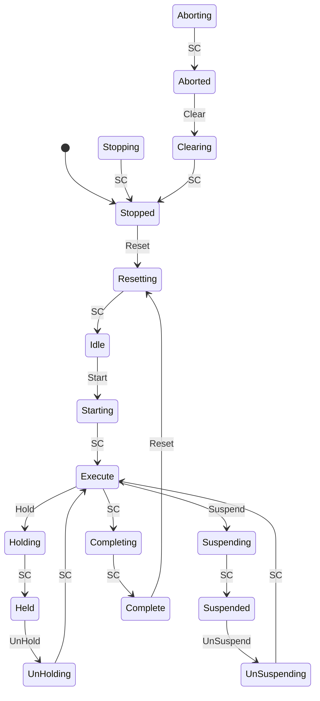

# 🏭 PackML State Machine in CODESYS — Structured Text, UDTs & Function Blocks

> A reusable PackML (ISA-88 / OMAC) state machine for PLCs: 17 states, 3 modes, written in IEC 61131-3 Structured Text with User-Defined Types and a function block, running on the CODESYS Control Win V3 x64 soft PLC.

[](https://en.wikipedia.org/wiki/Structured_text)
[](https://www.omac.org/packml)
[](https://www.codesys.com/)
[](https://store.codesys.com/)
[](https://en.wikipedia.org/wiki/IEC_61131-3)

---

## 📖 Table of Contents

- [About](#about)
- [Architecture Overview](#architecture-overview)
- [Project Structure](#project-structure)
- [Technologies Used](#technologies-used)
- [Prerequisites](#prerequisites)
- [Installation](#installation)
- [Usage](#usage)
- [The PackML State Model](#the-packml-state-model)
- [User-Defined Types](#user-defined-types)
- [Function Block Reference](#function-block-reference)
- [Demo Program](#demo-program)
- [Testing](#testing)
- [Version Control Notes](#version-control-notes)
- [Troubleshooting](#troubleshooting)
- [Roadmap](#roadmap)
- [License](#license)
- [Author](#author)

---

## About

This project implements a complete **PackML state machine** as a reusable PLC library-style component:

1. A set of **User-Defined Types** (two enumerations and two structures) describes states, modes, commands and status.
2. A **function block** (`FB_PackMLStateMachine`) holds all transition logic: edge-detected commands, Abort > Stop priority, mode changes, and state timing.
3. A **demo program** (`PRG_Machine`) provides the machine behaviour for each acting state and a small production counter, so the whole model can be tested on a PC with no hardware.

The function block only decides **which state is active**. What the machine *does* in each state lives in your application code. That separation is what makes the block reusable on any machine.

This project demonstrates structured PLC programming: typed interfaces, separation of state logic from machine behaviour, edge-driven command handling, and version control for PLC code.

---

## Architecture Overview

```
          HMI / Watchlist / Auto-demo
                      │
                      │  GVL_PackML.Cmd, ModeRequest
                      ▼
  ┌─────────────────────────┐                    ┌──────────────┐
  │ FB_PackMLStateMachine   │◀── StateComplete ──│ PRG_Machine  │
  │ (edge detect + CASE)    │─── Status.State ──▶│ (machine     │
  └────────────┬────────────┘                    │  behaviour)  │
               │                                 └──────────────┘
               ▼
        GVL_PackML.Status
   (State, Mode, StateName, StateTime, ...)
```

Data flow per PLC scan:

```
Commands ──▶ R_TRIG edge detect ──▶ priority logic (Abort > Stop > normal flow)
         ──▶ CASE on current state ──▶ new state ──▶ Status published
         ──▶ PRG_Machine runs the behaviour of that state ──▶ StateComplete
```

---

## Project Structure

```
PackML-CODESYS/
├── PackML.fbsdev/                      # CODESYS 4 project folder
│   ├── Application.iecapp/
│   │   ├── DUTs/
│   │   │   ├── E_PackMLState.enum      # 17 PackML states
│   │   │   ├── E_PackMLMode.enum       # Producing / Maintenance / Manual
│   │   │   ├── ST_PackMLCommands.struct
│   │   │   └── ST_PackMLStatus.struct
│   │   ├── Function Blocks/
│   │   │   └── FB_PackMLStateMachine.fb.st   # State machine logic
│   │   ├── Functions/
│   │   │   ├── F_PackMLStateName.fn.st       # State enum to text
│   │   │   └── F_PackMLIsActing.fn.st        # Acting-state test
│   │   ├── GVLs/
│   │   │   └── GVL_PackML.gvl                # Commands, mode request, status
│   │   ├── Programs/
│   │   │   └── PRG_Machine.prg.st            # Demo machine behaviour
│   │   ├── PLC_PRG.prg.st                    # Calls PRG_Machine
│   │   ├── TaskConfiguration.json
│   │   └── Libraries.json
│   ├── ProjectInfo.json
│   └── Communication.settings.json     # Local gateway/device (git-ignored)
│
├── .gitignore
├── .gitattributes
├── LICENSE
└── README.md
```

> Folder names are shown as they appear in the CODESYS 4 project tree.

---

## Technologies Used

| Technology | Role |
|---|---|
| **IEC 61131-3 Structured Text** | All state machine and application logic |
| **CODESYS 4** | IDE for editing, building and debugging |
| **CODESYS Control Win V3 x64** | Soft PLC runtime on Windows (demo mode: 2 hours per start) |
| **PackML / ISA-88 (OMAC)** | State model, commands and mode concept |
| **User-Defined Types** | Enumerations and structures for a typed interface |
| **Function Blocks** | Reusable state machine component |
| **R_TRIG** | One-scan edge detection for every command |
| **Git / GitHub** | Version control for the project |

---

## Prerequisites

- Windows 10 / 11
- **CODESYS 4** IDE
- **CODESYS Control Win SL** (V3 x64) soft PLC from the CODESYS Store. Do not use *Control RTE SL* (dedicated real-time PCs) or *Virtual Control SL* (Linux / cloud).
- The CODESYS **gateway** running on `localhost:1217`
- **Git** for Windows, plus a GitHub account to publish the project

> The runtime's type must match the project device exactly. This project targets **CODESYS Control Win V3 x64**.

---

## Installation

### 1. Clone the repository

```bash
git clone https://github.com/mtassone1/PackML-CODESYS.git
cd PackML-CODESYS
```

### 2. Start the soft PLC

Right-click the **CODESYS Control Win** icon in the Windows system tray and choose **Start PLC**. Its splash screen should read *CODESYS Control Win V3 - x64*.

### 3. Open the project

Open `PackML.fbsdev` in CODESYS 4 and build it with **Build > Build**. It should finish with 0 errors.

### 4. Add the gateway and select the PLC

1. Open the **Device Browser**.
2. Click **+** next to the Gateway box and add `localhost`, port `1217`.
3. Select your PC in the list under the gateway.

### 5. Download and start

Download the application to the PLC, then press the **play** button. The status badge changes from *Stopped* to *Running*.

---

## Usage

Open the **Watchlist** tab and add:

```
GVL_PackML.Status        (StateName, State, StateTime, Mode)
GVL_PackML.Cmd           (Reset, Start, Stop, Hold, UnHold, Suspend, UnSuspend, Abort, Clear)
PRG_Machine.nProduced
```

Write `TRUE` to a command bit to issue that command. `PRG_Machine` clears all commands every scan, so one write acts as one pulse.

Typical production cycle:

```
Reset ──▶ Start ──▶ (Execute until the batch is done) ──▶ Complete ──▶ Reset
```

Prefer not to write values by hand? Keep `bAutoDemo := TRUE` in `PRG_Machine` and the program issues the commands itself.

---

## The PackML State Model

The machine starts in **Stopped**. Commands are accepted on their **rising edge** only, so a button held down cannot re-trigger transitions.



`SC` = `StateComplete`, set by the machine logic when an acting state has finished its work.

**Stop and Abort** are not drawn for clarity:

| Command | Accepted in | Result |
|---|---|---|
| **Abort** | Every state except Aborted, Aborting, Clearing | Aborting |
| **Stop** | Every state except Stopped, Stopping, Aborted, Aborting, Clearing | Stopping |

Priority is **Abort > Stop > everything else**.

### Acting and wait states

| Kind | States |
|---|---|
| Acting (finish by themselves, end on `StateComplete`) | Clearing, Starting, Stopping, Aborting, Holding, UnHolding, Suspending, UnSuspending, Resetting, Completing |
| Wait (stay until a command arrives) | Stopped, Idle, Held, Suspended, Complete, Aborted |
| Production | Execute (runs until Hold, Suspend or `StateComplete`) |

> Hold and Suspend are accepted from **Execute** only, to keep the model easy to follow. The PackML specification allows more source states; extend the conditions in the function block if your machine requires it.

### Modes

| Mode | Value | Notes |
|---|---|---|
| Producing | 1 | Default |
| Maintenance | 2 | |
| Manual | 3 | |

A mode change is only accepted in **Stopped** or **Aborted**.

---

## User-Defined Types

| Type | Kind | Purpose |
|---|---|---|
| `E_PackMLState` | Enumeration | The 17 standard states, numbered as in PackML (Clearing = 1 ... Complete = 17) |
| `E_PackMLMode` | Enumeration | Undefined, Producing, Maintenance, Manual |
| `ST_PackMLCommands` | Structure | Reset, Start, Stop, Hold, UnHold, Suspend, UnSuspend, Abort, Clear |
| `ST_PackMLStatus` | Structure | State, Mode, StateName, StateTime, StateChanged, IsActing, IsWaiting |

Both enumerations use `{attribute 'qualified_only'}` and `{attribute 'strict'}`, so values are written `E_PackMLState.Idle` and cannot be assigned from plain integers.

`StateComplete` is deliberately **not** part of `ST_PackMLCommands`. It is produced by the machine logic, so it is an input of the function block instead.

---

## Function Block Reference

`FB_PackMLStateMachine`

| Direction | Name | Type | Description |
|---|---|---|---|
| Input | `Cmd` | `ST_PackMLCommands` | Operator / HMI commands, edge triggered |
| Input | `ModeRequest` | `E_PackMLMode` | Requested mode, applied in Stopped or Aborted |
| Input | `StateComplete` | `BOOL` | Rising edge ends the current acting state |
| Output | `Status` | `ST_PackMLStatus` | Current state, mode, name, time in state, flags |

Helper functions:

| Function | Returns | Description |
|---|---|---|
| `F_PackMLStateName(eState)` | `STRING(20)` | Text name of a state |
| `F_PackMLIsActing(eState)` | `BOOL` | TRUE for the 10 acting states |

Minimal usage:

```iecst
fbPackML(Cmd           := GVL_PackML.Cmd,
         ModeRequest   := GVL_PackML.ModeRequest,
         StateComplete := bStateComplete);

GVL_PackML.Status := fbPackML.Status;
```

### Global variable list (CODESYS 4 syntax)

```iecst
{attribute 'qualified_only'}
NAMESPACE GVL_PackML
VAR_GLOBAL

Cmd         : ST_PackMLCommands;
ModeRequest : E_PackMLMode := E_PackMLMode.Producing;
Status      : ST_PackMLStatus;

END_VAR
END_NAMESPACE
```

---

## Demo Program

`PRG_Machine` shows how to attach behaviour to the states:

- Each acting state "works" for **2 seconds**, then raises `StateComplete`.
- In **Execute**, one item is produced per second (`nProduced`).
- After `nBatchSize` items (default 10), it requests **Completing**.
- `nProduced` is cleared during **Resetting**.
- Optional `bAutoDemo` issues Reset, Start, one Hold per batch and UnHold on its own, cycling through the states without manual writes.

Replace this logic with your real machine behaviour.

---

## Testing

Follow this sequence in the watchlist (or let `bAutoDemo` run it):

| Step | Action | Expected result |
|---|---|---|
| 1 | Observe at start | Stopped |
| 2 | `Cmd.Reset` | Resetting for 2 s, then Idle |
| 3 | `Cmd.Start` | Starting for 2 s, then Execute |
| 4 | Wait about 10 s | `nProduced` reaches 10, then Completing, then Complete |
| 5 | `Cmd.Reset` | Resetting, then Idle (`nProduced` = 0) |
| 6 | Start, then `Cmd.Hold` in Execute | Holding, then Held |
| 7 | `Cmd.UnHold` | UnHolding, then Execute (count continues) |
| 8 | `Cmd.Suspend`, wait, `Cmd.UnSuspend` | Suspending, Suspended, UnSuspending, Execute |
| 9 | `Cmd.Stop` in Execute | Stopping, then Stopped |
| 10 | `Cmd.Abort` in any state | Aborting, then Aborted |
| 11 | `Cmd.Clear` | Clearing, then Stopped |
| 12 | `Cmd.Start` while in Stopped | No effect (invalid transitions are ignored) |
| 13 | `Cmd.Abort` while in Stopping | Aborting (Abort has priority) |

---

## Version Control Notes

- A CODESYS 4 project is a **folder of text files**, so Git shows real line-by-line diffs and can merge them. Commit the whole `PackML.fbsdev` folder.
- `Communication.settings.json` stores your gateway and device, which are specific to each PC. It is listed in `.gitignore`.
- Suggested commit prefixes: `feat:` new behaviour, `fix:` bug fix, `refactor:` no behaviour change, `docs:` README or comments.
- Tag baselines, for example `git tag -a v0.1.0 -m "First working PackML state machine"`.

---

## Troubleshooting

| Message | Cause | Fix |
|---|---|---|
| `VAR_GLOBAL declaration only allowed in global variable list` | GVL written in classic V3.5 style | Use the `NAMESPACE` form shown above |
| `Identifier 'GVL_PackML' not defined` | The GVL has its own error | Check the PRECOMPILE tab and fix the GVL first |
| `No Gateway configured` | The project has no gateway yet | Device Browser > **+** > `localhost`, port `1217` |
| `Gateway connection could not be established` | Gateway not running, or wrong address | Start the gateway, try `127.0.0.1` |
| `Device name is missing!` | No PLC selected | Select your PC in the Device Browser |
| Empty device list | Soft PLC not running or not installed | Tray icon > **Start PLC** |
| `ERR_ID_MISMATCH` | Project device type differs from the runtime | Add a PLC of the runtime's type, then move `Application` under it |
| Everything stays at `Undefined` / `T#0ms` | Application downloaded but not started | Press the **play** button |

---

## Roadmap

- [ ] Different state models per mode (for example, disable states in Manual)
- [ ] PackTags: counters, admin and alarm structures, machine speed
- [ ] Visualization with command buttons and a live state diagram
- [ ] Per-state function blocks for real machine sequences
- [ ] OPC UA exposure of `GVL_PackML` for SCADA / MES
- [ ] Automated tests that replay the sequence above and check `Status.State`

---
## License

Released under the [MIT License](LICENSE).

## Author

**mtassone1** — [github.com/mtassone1](https://github.com/mtassone1)
